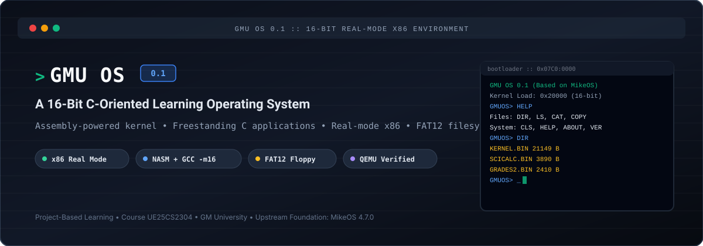
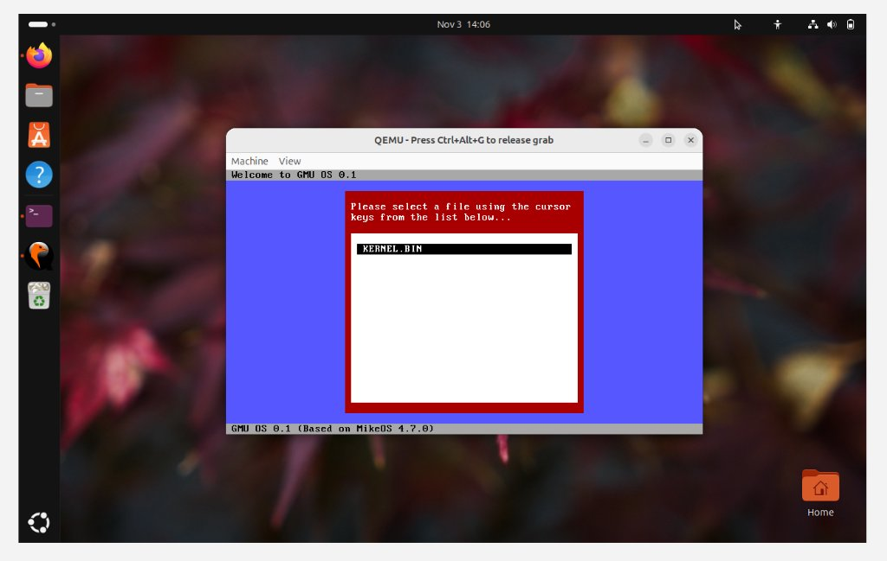
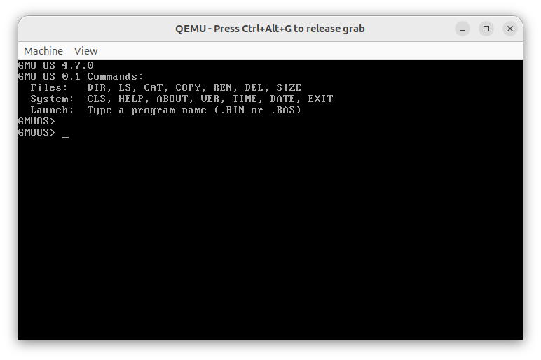
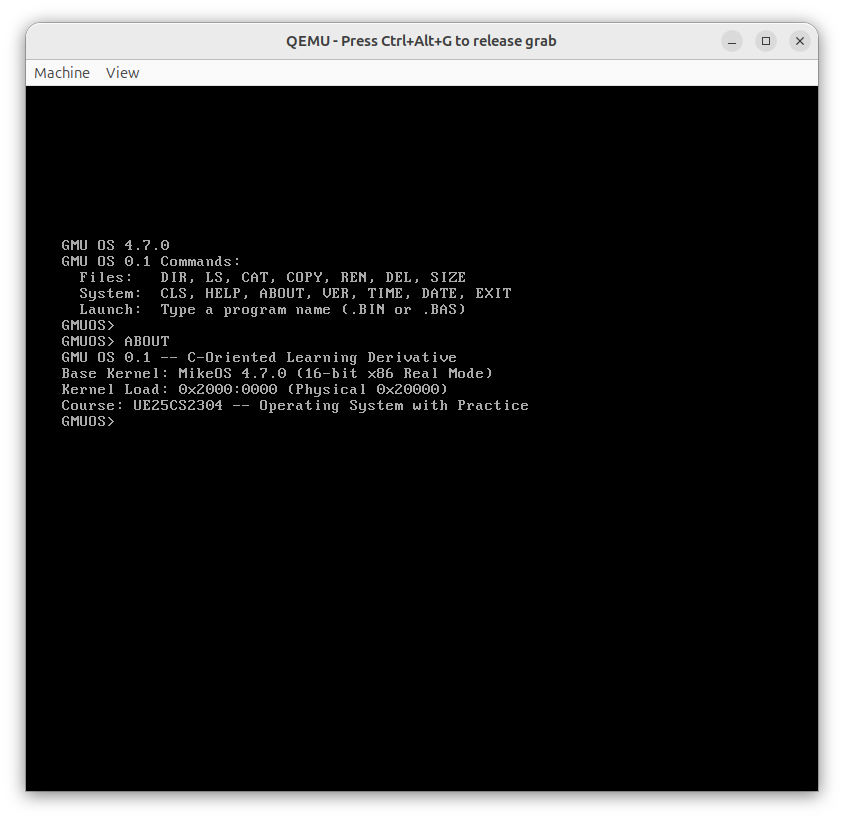
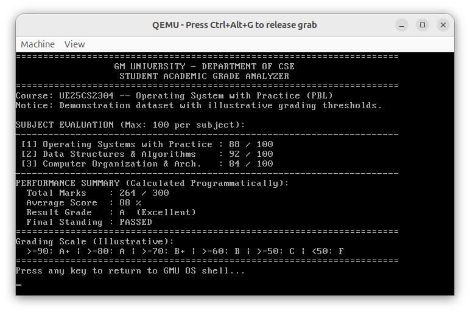
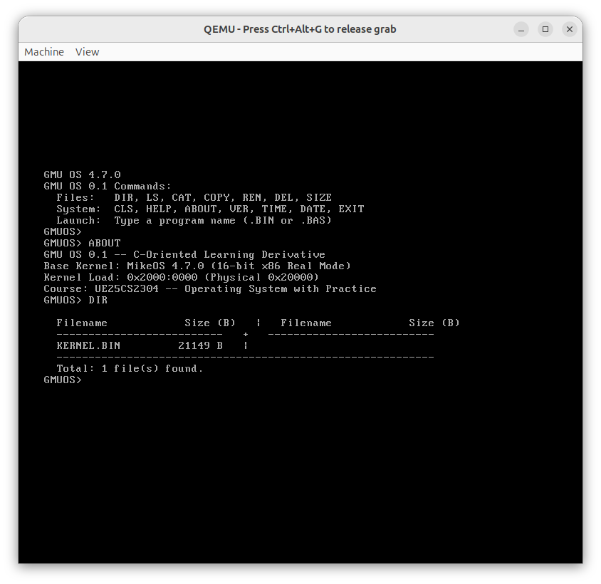
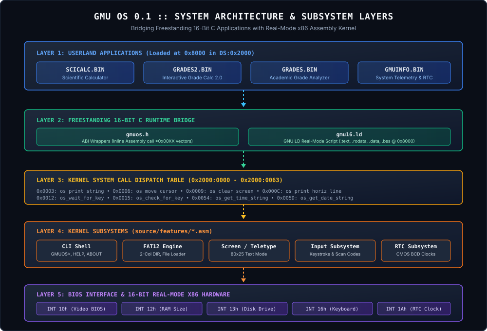

<div align="center">



# GMU OS 0.1
### A 16-Bit C-Oriented Learning Operating System

[](docs/ARCHITECTURE.md)
[](docs/BUILD_AND_RUN.md)
[](docs/COMMAND_REFERENCE.md)
[](LICENSE-ATTRIBUTION.md)

*Assembly-powered kernel. Freestanding C application environment. Real-mode x86 hardware interfaces.*

</div>

---

## 1. Introduction

**GMU OS 0.1** is an educational, 16-bit real-mode operating system developed as an individual Project-Based Learning (PBL) curriculum for course **UE25CS2304 (Operating System with Practice)** at **GM University, Davanagere, Karnataka, India**.

Built upon the rock-solid foundation of [MikeOS 4.7.0](https://mikeos.sourceforge.net/) created by Mike Saunders and open-source contributors, GMU OS bridges the gap between low-level assembly operating system internals and high-level C systems programming.

### The Problem It Solves
Most modern operating systems textbooks teach OS concepts at an abstract theoretical level or require thousands of lines of complex protected-mode driver code. GMU OS takes a different approach:
* **The Bare-Metal Assembly Core**: The master boot record (MBR) bootloader and core kernel remain in lightweight, accessible 16-bit real-mode x86 assembly, interfacing directly with BIOS firmware routines (`INT 10h`, `INT 12h`, `INT 13h`, `INT 16h`, `INT 1Ah`).
* **The Freestanding C Application Layer**: Rather than requiring students to write all user utilities in assembly, GMU OS introduces a freestanding C runtime (`c_src/include/gmuos.h`) and custom linker script (`c_src/gmu16.ld`). Students can develop interactive utilities, mathematical calculation engines, and systems tools in pure C, compiling directly to real-mode 16-bit flat binaries (`.BIN`) executing at offset `0x8000`.

---

## 2. Live QEMU Execution Showcase

The following screenshots are genuine, unedited captures from actual QEMU emulator execution running bootable floppy disk images (`disk_images/gmuos.flp`):

| Operating System Interface | Command Execution |
| :---: | :---: |
| <br>**Custom Welcome Screen Branding** (`source/kernel.asm`) | <br>**Shell Interface with `GMUOS> ` Prompt** (`cli.asm`) |
| <br>**Categorized Command Overview (`HELP`)** | <br>**System Metadata & Load Offsets (`ABOUT`)** |
| <br>**Freestanding 16-Bit C Analyzer (`GRADES.BIN`)** | <br>**2-Column Balanced Directory Listing (`DIR`)** |

---

## 3. System Architecture

GMU OS is organized into five clean architectural layers. User applications execute in the same 64 KB segment as the kernel (`0x2000`), with the stack located at the top of the segment (`0x2000:0xFFFE`) growing downward, and user programs loaded at offset `0x8000`.

<div align="center">



</div>

### Memory Organization (1 MB Real-Mode Address Space)

```
0x00000 ┌────────────────────────────────────────────────────────┐
        │ Interrupt Vector Table (IVT - 256 x 4-Byte Vectors)     │ 1 KB
0x00400 ├────────────────────────────────────────────────────────┤
        │ BIOS Data Area (BDA - Hardware status and equipment)   │ 256 Bytes
0x07C00 ├────────────────────────────────────────────────────────┤
        │ Boot Sector MBR (bootload.asm - Loaded by BIOS INT 19h) │ 512 Bytes
0x08000 ├────────────────────────────────────────────────────────┤
        │ Transient Program Area (TPA)                            │
        │ User C Applications (SCICALC.BIN, GRADES2.BIN, etc.)   │ Up to 64 KB
0x20000 ├────────────────────────────────────────────────────────┤
        │ GMU OS 0.1 Kernel (Segment 0x2000:0000)                │
        │ • Jump-Table System Call Vectors (0x0000 - 0x0063)     │
        │ • CLI Shell, Video Drivers, FAT12 Disk Engine          │ 64 KB Segment
0x60000 ├────────────────────────────────────────────────────────┤
        │ Floppy Disk Staging Buffer (disk_buffer)               │
        │ Direct FAT12 Root Directory Cache (Sectors 19–32)       │ 64 KB Buffer
0x80000 ├────────────────────────────────────────────────────────┤
        │ System Stack (SS:SP = 0x2000:0xFFFE, grows downwards)   │ Real-Mode Stack
0xA0000 ├────────────────────────────────────────────────────────┤
        │ Video RAM (VRAM) Text Buffer (0xB800:0000)             │ 80x25 Screen
0xF0000 ├────────────────────────────────────────────────────────┤
        │ System Motherboard BIOS ROM (Reset Vector @ 0xFFFF0)   │ 64 KB ROM
0xFFFFF └────────────────────────────────────────────────────────┘
```

For comprehensive details on segment registers and memory layout, see [docs/MEMORY_MAP.md](docs/MEMORY_MAP.md).

---

## 4. Key Features

* **Custom Kernel Branding**: System banners, version queries (`VER`), and dialog frames customized to `GMU OS 0.1` while preserving upstream vector tables.
* **Streamlined Command Line Interface (`source/features/cli.asm`)**:
  * Distinctive shell prompt: `GMUOS> `.
  * Structured `HELP` system grouping commands into *Files*, *System*, and *Launch*.
  * Built-in `ABOUT` command detailing kernel load segment (`0x2000:0000`), physical memory address (`0x20000`), and university metadata.
* **Direct FAT12 Directory Traversal (`DIR`)**:
  * Reads the entire 14-sector root directory (sectors 19–32) in a single BIOS `INT 13h` burst.
  * Filters out volume labels, subdirectories, deleted files (`0xE5`), and VFAT long filenames (`0x0F`).
  * 32-bit binary to 10-digit decimal size converter with balanced 2-column formatting (max width 61 chars) and file count summary.
* **Freestanding 16-Bit C Runtime (`c_src/`)**:
  * Custom linker script (`gmu16.ld`) mapping `.text.startup`, `.text`, `.rodata`, `.data`, and `.bss` to `0x8000`.
  * Inline assembly ABI bridge (`gmuos.h`) mapping C calls to kernel jump table vectors without runtime overhead.

---

## 5. Application Deep-Dive

GMU OS features an expanding suite of freestanding real-mode C applications:

### 1. `SCICALC.BIN` — Modular Scientific Calculator
* **Source Path**: [`c_src/scientific_calc/`](c_src/scientific_calc/)
* **Engine Architecture**: Modular separation between console UI (`scientific_calc.c`) and pure mathematical engine (`math.c`, `math.h`).
* **Trigonometric Capabilities**: Degree-based implementations of `sin`, `cos`, `tan`, `sec`, `cosec`, and `cot` using 7th-order Taylor series polynomials with quadrant reduction:
  $$\sin(x) \approx x - \frac{x^3}{3!} + \frac{x^5}{5!} - \frac{x^7}{7!}$$
* **Exact Radical Formatting**: Detects standard angle evaluations ($0^\circ, 30^\circ, 45^\circ, 60^\circ, 90^\circ$) and displays exact fraction/radical results (e.g. `1/2`, `sqrt(2)/2`, `sqrt(3)/2`, `1`, `UNDEFINED`) rather than truncated floating-point noise.
* **Windows Desktop Preview**: Includes a standalone Python terminal emulator ([`preview_calc.py`](c_src/scientific_calc/preview_calc.py)) for rapid mathematical verification on Windows without booting QEMU.

### 2. `GRADES2.BIN` — Interactive Student Grade Calculator 2.0
* **Source Path**: [`c_src/examples/grades2.c`](c_src/examples/grades2.c)
* **Interactive Capabilities**: Dynamic student name input, variable subject count (1 to 10), subject names, maximum marks, and obtained marks.
* **BSS Zeroing Remediation**: Explicitly zeroes uninitialized global memory (`initialize_data()`) on startup, preventing corruption from dirty loader RAM.
* **Overflow & Input Sanitization**: Custom line editor with backspace screen retraction (`\b \b`), enter termination, and pre-multiplication 32-bit integer overflow protection (`value > (maximum - digit) / 10`).

### 3. `GRADES.BIN` — Static Academic Grade Analyzer
* **Source Path**: [`c_src/examples/grades.c`](c_src/examples/grades.c)
* **Purpose**: Demonstrates baseline 16-bit freestanding C integration using programmatic 32-bit integer arithmetic and letter-grade decision logic.
* **Status**: **QEMU-Validated** (see [`05_grades_c_app.png`](assets/screenshots/05_grades_c_app.png)).

### 4. `GMUINFO.BIN` — System Telemetry & Hardware Info
* **Source Path**: [`c_src/examples/gmuinfo.c`](c_src/examples/gmuinfo.c)
* **Hardware Queries**: Queries kernel API version (vector `0x0057`), CMOS RTC real-time clock (`0x0054`), CMOS RTC date (`0x005D`), BIOS conventional RAM via `INT 12h`, and CPU segment registers (`CS`, `DS`, `SS`).

---

## 6. Installation & Quickstart

### Prerequisites
On Ubuntu Linux or an Ubuntu VirtualBox VM, install the required build tools:

```bash
sudo apt update
sudo apt install -y nasm gcc gcc-multilib binutils dosfstools mtools qemu-system-x86
```

### 1-Step Automated Build
```bash
# Clone the repository
git clone https://github.com/Unstocks/clg-os.git
cd clg-os

# Grant script execution permissions
chmod +x build-gmu-linux.sh scripts/*.sh c_src/*.sh

# Run master build (sudo required for loopback mounting floppy image)
sudo ./build-gmu-linux.sh
```

### Running in QEMU
```bash
./test-linux.sh
```
*Or directly via QEMU CLI:*
```bash
qemu-system-i386 -soundhw pcspk -drive format=raw,file=disk_images/gmuos.flp,index=0,if=floppy
```

### Testing on Windows (No Compiler Required)
```powershell
python c_src/scientific_calc/preview_calc.py
```

---

## 7. Command Reference

At the `GMUOS> ` prompt, the following built-in commands and applications are supported:

| Command | Category | Description |
| :--- | :--- | :--- |
| `HELP` | System | Displays categorized command overview (Files, System, Launch). |
| `ABOUT` | System | Displays kernel load segment (`0x2000`), physical RAM address, and course info. |
| `DIR` | Files | Balanced 2-column FAT12 directory listing with 10-digit byte sizes and summary count. |
| `LS` | Files | Compact multi-column filename listing (legacy display). |
| `CAT <file>` | Files | Displays text contents of a file on the console (e.g., `CAT GMU_OS.TXT`). |
| `CLS` | System | Clears screen and repositions cursor to top-left corner. |
| `VER` | System | Prints operating system and upstream kernel version. |
| `TIME` / `DATE`| System | Queries CMOS RTC for real-time clock and calendar date. |
| `SCICALC.BIN` | App | Launches interactive scientific calculator. |
| `GRADES2.BIN` | App | Launches interactive grade calculator with input validation. |
| `GRADES.BIN` | App | Launches static academic grade analyzer demonstration. |
| `GMUINFO.BIN` | App | Queries and prints hardware telemetry, BIOS RAM, and segment registers. |
| `EXIT` | System | Reboots the system via BIOS warm restart. |

For detailed syntax and parameter options, see [docs/COMMAND_REFERENCE.md](docs/COMMAND_REFERENCE.md).

---

## 8. Repository Structure

```
clg-os/
├── assets/                    <- Visual assets (banner, architecture diagrams, screenshots)
├── source/                    <- Assembly kernel and bootloader sources
│   ├── bootload/              <- MBR bootloader (bootload.asm)
│   ├── features/              <- Kernel subsystem drivers (cli.asm, disk.asm, etc.)
│   └── kernel.asm             <- Vector jump table and kernel initialization
├── c_src/                     <- Freestanding C runtime environment
│   ├── examples/              <- C applications (grades.c, grades2.c, gmuinfo.c)
│   ├── include/gmuos.h        <- System call wrappers and ABI macros
│   ├── scientific_calc/       <- Scientific calculator source & Python preview
│   ├── gmu16.ld               <- 16-bit real-mode linker script
│   └── build-c-linux.sh       <- Dedicated C compilation pipeline
├── programs/                  <- Assembled binaries, BASIC games, and PCX image files
├── scripts/                   <- Linux build and test automation scripts
├── docs/                      <- In-depth technical engineering documentation
├── evidence/                  <- Weekly academic milestone reports and diff patches
└── disk_images/               <- Output staging for floppy disk images
```

---

## 9. 10-Week Development Roadmap

The operating system curriculum follows a rigorous 10-week lifecycle. Every milestone distinguishes static source validation from live QEMU execution verification:

| Week | Milestone Description | Target Subsystem | Implementation Status | Verification Status |
| :---: | :--- | :--- | :---: | :---: |
| **00** | Read-Only Baseline Audit & Setup | Entire Repository | **COMPLETED** | Verified (104/104 Baseline Hashed) |
| **01** | Welcome Screen Branding | `source/kernel.asm` | **COMPLETED** | **QEMU Screen Verified** |
| **02** | Custom Command Prompt (`GMUOS> `) | `source/features/cli.asm` | **COMPLETED** | **QEMU Screen Verified** |
| **03** | Interactive HELP System Enhancement | `source/features/cli.asm` | **COMPLETED** | **QEMU Screen Verified** |
| **04** | Internal CLI Command (`ABOUT`) | `source/features/cli.asm` | **COMPLETED** | **QEMU Screen Verified** |
| **05** | 16-bit Freestanding C App Integration | `c_src/examples/grades.c` | **COMPLETED** | **QEMU Screen Verified** |
| **06** | Richer SYSINFO Display in C | `c_src/examples/gmuinfo.c` | **STAGE A IMPLEMENTED** | Source Validated |
| **07** | Enhanced FAT12 Directory Traversal (`DIR`) | `source/features/cli.asm` | **COMPLETED** | **QEMU Screen Verified** |
| **08** | OS Service / System Call & C Wrapper | `source/kernel.asm`, `gmuos.h`| **IN PROGRESS** | Pending Integration |
| **09** | Disk Subsystem & File Management Behavior | `source/features/disk.asm` | **SCHEDULED** | Pending Integration |
| **10** | Capstone OS Extension & Final Synthesis | Full System | **SCHEDULED** | Pending Integration |

For the complete milestone tracking log, see [docs/DEVELOPMENT_ROADMAP.md](docs/DEVELOPMENT_ROADMAP.md).

---

## 10. Key Engineering Challenges & Solutions

1. **The Floppy Loader BSS Hazard**: Real-mode floppy loaders do not clear uninitialized memory. C global variables contain dirty RAM remnants unless explicitly wiped via `initialize_data()` at startup.
2. **Preventing 16-Bit Integer Overflow**: Standard `int` maxes out at `+32,767`. Calculating student percentages (`marks * 100`) easily exceeds `10,000,000`. Calculations must use explicit `long` (32-bit) arithmetic and pre-multiplication bounds checks.
3. **Single-Burst FAT12 Root Traversal**: Replaced slow sector-by-sector disk seeks with a single 14-sector read of sectors 19–32 into `0x6000`, parsing all 224 directory entries in RAM.
4. **BIOS Teletype DX Preservation**: In clone BIOS implementations, `INT 10h, AH=0Eh` can corrupt `DX`. Routines in `cli.asm` explicitly preserve `DX` with `push dx / pop dx` to protect character counters and column state.

For deeper analysis of design choices, see [docs/TECHNICAL_DECISIONS.md](docs/TECHNICAL_DECISIONS.md).

---

## 11. Upstream Attribution & Licensing

* **Base Operating System**: [MikeOS 4.7.0](https://mikeos.sourceforge.net/)  
* **Upstream Authors**: Copyright &copy; 2006–2022 Mike Saunders and MikeOS Contributors.  
* **License**: BSD 3-Clause License (Preserved in full in [`LICENSE-ATTRIBUTION.md`](LICENSE-ATTRIBUTION.md) and [`doc/LICENSE.TXT`](doc/LICENSE.TXT)).  

The name "MikeOS" is used solely for attribution and provenance. MikeOS developers do not endorse or sponsor this derivative project.

---

## 12. Author & Academic Context

* **Developer**: **Sanjayakumar S H**  
* **Department**: Department of Computer Science & Engineering (AI-BC-BS)  
* **Institution**: **GM University**, Davanagere, Karnataka, India  
* **Course**: **UE25CS2304 — Operating System with Practice (PBL)**  
* **GitHub Organization**: [Unstocks](https://github.com/Unstocks)  
* **Repository**: [https://github.com/Unstocks/clg-os](https://github.com/Unstocks/clg-os)  

