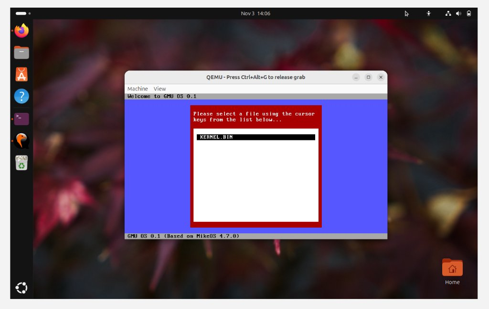

# Milestone 01 — Welcome Screen Branding

- **Target Source**: \$(System.Collections.Hashtable.Target)\
- **Verification Status**: **QEMU Screen Verified**
- **Unified Diff Patch**: [\$(System.Collections.Hashtable.Patch)\](source_changes/kernel_asm_diff.patch)

---

## 1. Description & Scope
Updated os_init_msg, os_version_msg, and dialog_string_1 to brand the operating system as GMU OS 0.1 while preserving vector table offsets.

---

## 2. Verification Evidence

### Execution Screenshot

- **Patch**: See unified patch in \source_changes/kernel_asm_diff.patch\ for exact line-by-line diff against baseline.