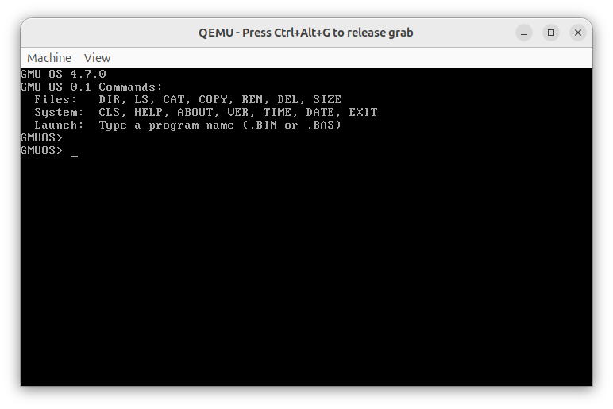

# Milestone 02 — Custom Command Prompt

- **Target Source**: \$(System.Collections.Hashtable.Target)\
- **Verification Status**: **QEMU Screen Verified**
- **Unified Diff Patch**: [\$(System.Collections.Hashtable.Patch)\](source_changes/cli_prompt_diff.patch)

---

## 1. Description & Scope
Updated command line shell prompt definition from default '> ' to 'GMUOS> '.

---

## 2. Verification Evidence

### Execution Screenshot

- **Patch**: See unified patch in \source_changes/cli_prompt_diff.patch\ for exact line-by-line diff against baseline.