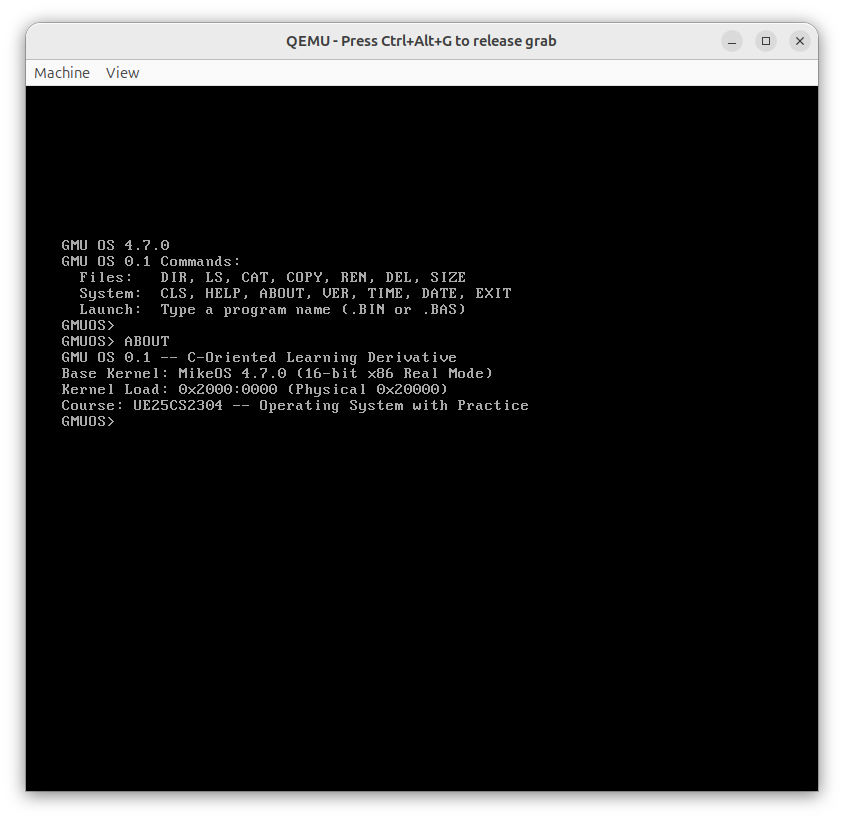

# Milestone 04 — New ABOUT Command

- **Target Source**: \$(System.Collections.Hashtable.Target)\
- **Verification Status**: **QEMU Screen Verified**
- **Unified Diff Patch**: [\$(System.Collections.Hashtable.Patch)\](source_changes/cli_about_diff.patch)

---

## 1. Description & Scope
Implemented ABOUT command token comparison, dispatch table registration, and output handler displaying kernel load segment and academic metadata.

---

## 2. Verification Evidence

### Execution Screenshot

- **Patch**: See unified patch in \source_changes/cli_about_diff.patch\ for exact line-by-line diff against baseline.