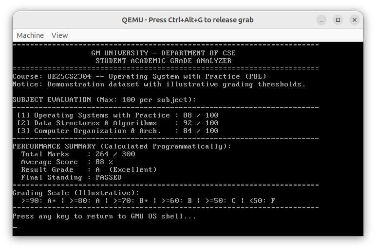

# Milestone 05 — 16-bit Freestanding C App Integration

- **Target Source**: \$(System.Collections.Hashtable.Target)\
- **Verification Status**: **QEMU Screen Verified**
- **Unified Diff Patch**: [\$(System.Collections.Hashtable.Patch)\](source_changes/c_app_diff.patch)

---

## 1. Description & Scope
Integrated freestanding C application GRADES.BIN compiled with gcc -m16, calculating marks, percentages, and letter grades using 32-bit integer arithmetic.

---

## 2. Verification Evidence

### Execution Screenshot

- **Patch**: See unified patch in \source_changes/c_app_diff.patch\ for exact line-by-line diff against baseline.