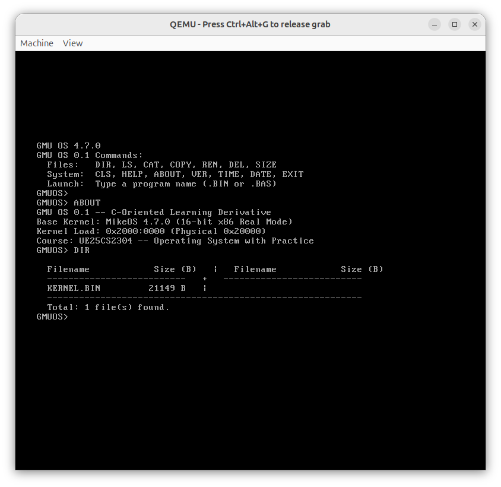

# Milestone 07 — Enhanced 2-Column FAT12 DIR Listing

- **Target Source**: \$(System.Collections.Hashtable.Target)\
- **Verification Status**: **QEMU Screen Verified**
- **Unified Diff Patch**: [\$(System.Collections.Hashtable.Patch)\](source_changes/cli_dir_enhance_diff.patch)

---

## 1. Description & Scope
Direct FAT12 root-directory parser reading sectors 19-32 into disk_buffer, filtering system/volume entries, and formatting a balanced 2-column display with 10-digit file sizes (61-col max width).

---

## 2. Verification Evidence

### Execution Screenshot

- **Patch**: See unified patch in \source_changes/cli_dir_enhance_diff.patch\ for exact line-by-line diff against baseline.